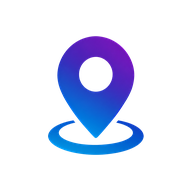

<p align="center"></p>

# HiperTracker

Live GPS tracking of staff and vehicles inside **Hipersign ERP**. The HiperTracker phone app sends its locations straight to the ERP, so no Traccar server or Traccar API is needed.

Open the **HiperTracker** workspace and you get a live Google map of Kerala with every tracked phone on it:

- a coloured marker per phone: **green** online, **red** offline, **flashing orange** when the worker has switched GPS off, **grey** when checked out
- a label with the vehicle number or person's name and their current speed (truck icon for vehicles, person icon for staff)
- counters for total, online, offline and GPS-off devices, and average moving speed
- click a marker for the person, their head, phone, speed, last update, battery, directions and **route history** for any day
- a searchable list of all devices under the map; refreshes every 30 seconds

## How a phone is matched to a person

Every phone has a **Device ID** (e.g. `48213907`) and a private **device key**. Both live on its record in **HiperTracker → Devices & People**, together with the *Employee* who carries it and their *Head*. A phone gets them in one of two ways:

- the worker logs in to the app with their ERP username and password (their Employee needs that *User ID*); a record is created for them automatically, or
- open the record and scan its **Phone setup QR** with the app (⚙ Settings → QR icon).

Or, like Traccar, just type the server address in the app: **`https://nexus365.hipersignerp.cloud`** (the same for everyone). The phone is known by its *Identifier*; a phone ERP hasn't seen yet is added to Devices & People as *Phone &lt;ID&gt;* and you only set its Employee. Turn on *Require device key* in HiperTracker Settings to accept only phones set up by login or QR.

## Installation

```bash
cd ~/frappe-bench
bench get-app https://github.com/hipersignerp-dev/HiperTracker
bench --site <your-site> install-app hipertracker
bench --site <your-site> migrate
```

Installing creates:

- the **HiperTracker** workspace with the live map
- the **HiperTracker** desktop tile (with the logo) and sidebar
- doctypes **HiperTracker Device**, **HiperTracker Position** (location history) and **HiperTracker Settings**
- roles **HiperTracker Manager** (full access) and **HiperTracker User** (view the map; give this to heads)

If HiperTracker was first set up by hand on the site (as on Nexus), installing takes over those records and keeps their data.

## Who sees what

| Role | Sees |
|---|---|
| System Manager, HiperTracker Manager | All devices; can add and edit them |
| HiperTracker User | Devices they can read in *HiperTracker Device* (use User Permissions to limit a head to their team) |

## Check in / check out and alerts

- Workers **Check In / Check Out** in the app; each is saved as an *Employee Checkin* with the location. With *Track only between check in and check out* on (HiperTracker Settings), tracking and the GPS alarm run only while checked in.
- If a worker switches location off, the phone rings an alarm and repeats it every *Alarm Interval* seconds. When it escalates, the **head** gets an ERP notification and an email (the device's *Head*, or else the Employee's *Reports To*).
- If a checked-in phone sends nothing for *Offline After* minutes (phone off, no internet, app stopped), the head is told as well. Alerts repeat at most every *Repeat Alerts Every* minutes.
- Emails need an outgoing email account in ERP (*Email Account* with *Enable Outgoing* and *Default Outgoing*).
- Location history is kept for *Keep Location History* days (default 90).

## License

MIT
